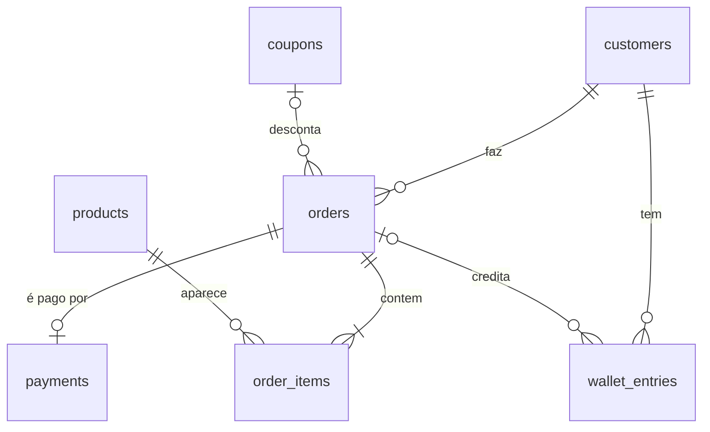

# game-store-mysql

Banco de dados e API da loja de um servidor de jogo: o jogador compra pacotes de moedas, VIP e kits, paga por PIX/cartão e as moedas caem numa carteira. O foco aqui é o MySQL: modelagem, constraints, transações e concorrência. A API em C# é fina de propósito e chama as procedures.

Fiz pensando na loja do meu servidor de DayZ, que hoje vende pacotes de moedas na mão.

## O que tem no banco



- **Constraints no próprio banco**: SteamID com 17 dígitos (`CHECK` com regex), cupom entre 1% e 90%, `total = subtotal - desconto`, pedido `paid` só com `paid_at` preenchido, pacote de moedas precisa ter moedas. Mesmo que alguém mexa direto no banco, dado inválido não entra.
- **Carteira em formato de livro-razão** (`wallet_entries`): nada é editado nem apagado, cada crédito ou débito é uma linha e o saldo é a soma. Dá pra auditar de onde veio cada moeda.
- **Preço congelado no item do pedido**: se o preço do produto mudar depois, o pedido antigo continua certo.
- **Views de relatório**: vendas por dia, produtos mais vendidos, resumo por cliente e saldo da carteira.

## As procedures e por quê

Tudo que precisa ser atômico fica numa procedure com transação. Regra quebrada sai como `SIGNAL SQLSTATE '45000'` com mensagem, e a API transforma em 404/409/422.

**`sp_place_order`** recebe o carrinho em JSON (lido com `JSON_TABLE`), trava as linhas dos produtos com `SELECT ... FOR UPDATE`, confere estoque e cupom, cria o pedido e baixa o estoque. Se qualquer passo falhar, `ROLLBACK` e nada muda. O `FOR UPDATE` é o que resolve o caso de duas pessoas comprando o último item ao mesmo tempo: a segunda fica esperando a primeira terminar e já enxerga o estoque zerado. Tem teste disso disparando as duas compras em paralelo.

**`sp_confirm_payment`** é chamada pelo webhook do provedor de pagamento e é idempotente. Provedor de pagamento reenvia a notificação quando não recebe resposta a tempo, então a mesma confirmação pode chegar duas vezes. A segunda volta `duplicate` e não credita moeda de novo (`UNIQUE (provider, provider_ref)` garante no nível do banco). Ela também confere se o valor pago bate com o total.

**`sp_spend_coins`** trava a linha do cliente antes de somar o saldo, pra dois gastos simultâneos não deixarem a carteira negativa. Também tem teste em paralelo.

**`sp_cancel_order`** devolve estoque e o uso do cupom.

## API

ASP.NET Core 10 com Dapper (SQL escrito à mão, sem ORM).

| Rota | |
|---|---|
| `GET /api/products` | catálogo |
| `POST /api/customers` | cadastro pelo SteamID |
| `GET /api/customers/{steamId}/wallet` | saldo e últimos lançamentos |
| `POST /api/customers/{steamId}/wallet/spend` | gasta moedas |
| `POST /api/orders` | cria pedido `{ steamId, items: [{ sku, qty }], coupon }` |
| `GET /api/orders/{id}` | detalhes |
| `POST /api/orders/{id}/cancel` | cancela pedido pendente |
| `POST /api/payments/webhook` | confirmação de pagamento, assinada com HMAC-SHA256 no header `X-Signature` |
| `GET /api/reports/sales?from=&to=` | vendas por dia |
| `GET /api/reports/top-products?limit=` | mais vendidos |

O webhook confere a assinatura em cima dos bytes exatos do corpo, com comparação em tempo constante. Sem isso qualquer um podia mandar "pedido pago" pra API.

Exemplo real rodando local:

```
POST /api/orders  {"steamId":"76561190000000001","items":[{"sku":"COINS_1200","qty":2},{"sku":"KIT_LENDA","qty":1}],"coupon":"LANCAMENTO"}
→ 201 {"id":1,"status":"pending","subtotalCents":13970,"discountCents":3492,"totalCents":10478, ...}

POST /api/payments/webhook   → 200 {"status":"paid"}
POST /api/payments/webhook   → 200 {"status":"duplicate"}     (mesma notificação de novo)

GET /api/customers/76561190000000001/wallet
→ 200 {"balance":2400,"recent":[{"amount":2400,"reason":"purchase","orderId":1}]}
```

Documentação interativa em `/scalar`.

## Rodando

Precisa de MySQL 8.0+ e .NET 10.

```sql
CREATE DATABASE gamestore;
CREATE USER 'gamestore'@'%' IDENTIFIED BY 'gamestore_dev';
GRANT ALL PRIVILEGES ON `gamestore%`.* TO 'gamestore'@'%';
```

```
dotnet run --project src/GameStore.Api
```

As migrations (`db/migrations/V###__*.sql`) rodam sozinhas na subida e ficam registradas em `schema_migrations`. O `db/seed.sql` tem produtos, cupons e clientes de exemplo. A senha e o segredo do webhook no `appsettings.json` são de desenvolvimento; em produção vêm de variável de ambiente (`ConnectionStrings__Store`, `Payments__WebhookSecret`).

O cliente do MySQL não entende `DELIMITER`, então os arquivos separam os comandos com uma linha `-- @@` e o migrator manda um por vez.

## Testes

```
dotnet test --solution GameStore.slnx
```

21 testes contra um MySQL de verdade (nada de banco em memória: o que interessa testar é justamente o comportamento do MySQL). Cada teste cria um banco novo, roda migrations e seed, e apaga no fim. Por padrão usa `127.0.0.1:3306` com o usuário acima; dá pra trocar com a variável `GAMESTORE_TEST_MYSQL`.

Os que eu acho mais importantes:

- duas compras do último item ao mesmo tempo, só uma passa;
- dois gastos de 400 moedas em paralelo com saldo 500, só um passa;
- a mesma notificação de pagamento duas vezes credita uma vez;
- falta de estoque desfaz tudo, inclusive o uso do cupom;
- constraints barram dado inválido mesmo sem passar pelas procedures.

No GitHub Actions os testes rodam com um container `mysql:8.4`.

## Estrutura

```
db/migrations/   V001 schema, V002 views, V003 procedures
db/seed.sql      dados de exemplo
src/GameStore.Api/
  Db/            migrator e tradução de erro do MySQL pra HTTP
  Endpoints/     rotas e DTOs
  Payments/      assinatura do webhook
tests/           xUnit v3
```
